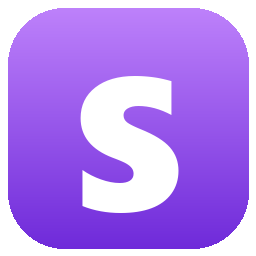

<p align="center">
  
</p>

<h1 align="center">SALES MACRO</h1>
<p align="center"><b>Bind it. Time it. Run it.</b><br>
A free, open-source macro app for Windows. Bind any key or mouse button to a sequence of key presses,
clicks, and typed text, with your own timing between every step.</p>

<p align="center">
  <a href="https://github.com/saleability/sales-macro/releases/latest"><b>⬇ Download SalesMacro.exe</b></a> ·
  <a href="https://discord.gg/rMkAf7tW9e"><b>Join the Discord</b></a>
</p>

---

## Features
- **Bind anything:** any key, combos like `Ctrl+F1`, or side mouse buttons (Mouse4 / Mouse5)
- **Build a sequence:** key taps, key hold/release, mouse clicks (at the cursor or a fixed spot), cursor moves, typed text, and waits
- **Your timing:** every step has its own *delay after* in milliseconds, accurate to about 1 ms
- **Reorder steps** with ▲ / ▼, duplicate them, or set many delays at once
- **Record mode:** captures what you actually do, real timing included
- **3 run modes:** run X times, toggle on/off, or loop while held
- **Stop-all key** (F12 by default) and a global ON/OFF switch
- **Humanize:** adds a random ± offset to delays
- **Import / Export** macros as `.json` to share with friends
- Auto-saves to `%APPDATA%\SalesMacro\macros.json`

## Download
Grab **SalesMacro.exe** from the [latest release](https://github.com/saleability/sales-macro/releases/latest) and run it.
You don't need to install anything.

> Windows SmartScreen may say "Windows protected your PC" because the exe isn't code-signed (signing costs money).
> Click **More info → Run anyway**. Prefer not to? Run or build it from source below.

## Is it safe?
All the code is in this repo. It's one readable file: [`sales_macro.py`](sales_macro.py).
- It makes **no network connections**. The only web link is the Discord button, which opens your browser.
- It reads keyboard and mouse input only to detect your binds and to record macros. Nothing is logged or sent anywhere.
- It only writes your own macro file in `%APPDATA%\SalesMacro`.

**Verify the download:** each release lists the exe's SHA-256. Compare it with:
```powershell
Get-FileHash .\SalesMacro.exe -Algorithm SHA256
```

## Run / build from source
Requires Python 3.10+.
```bash
pip install -r requirements.txt
python sales_macro.py
```
Build your own exe (output: `dist\SalesMacro.exe`):
```bash
build_exe.bat
```

## How to use
1. **+ New** to create a macro. Name it, click **Set** next to *Bind*, and press your key.
2. Add steps with **+ Key / + Click / + Move / + Text / + Wait**, or press **● Record**.
3. Double-click a step to edit it. **Delay after** is the gap before the next step.
4. Choose a **Mode**:
   - *Press = run (x times)*: runs the sequence *Repeat* times
   - *Press = start / press again = stop*: loops until you press the bind again
   - *Loop while held*: loops for as long as you hold the bind
5. Press **F12** to stop everything. Click the stop-key label in the top bar to change it.

## Notes
- Some games with anti-cheat block or ban macro input. Only use it where macros are allowed.
- If a game ignores the macro, run Sales Macro **as administrator**.

## Rebrand
Edit the `BRAND` block at the top of `sales_macro.py` (name, tagline, colors, Discord link).

## License
[MIT](LICENSE)
